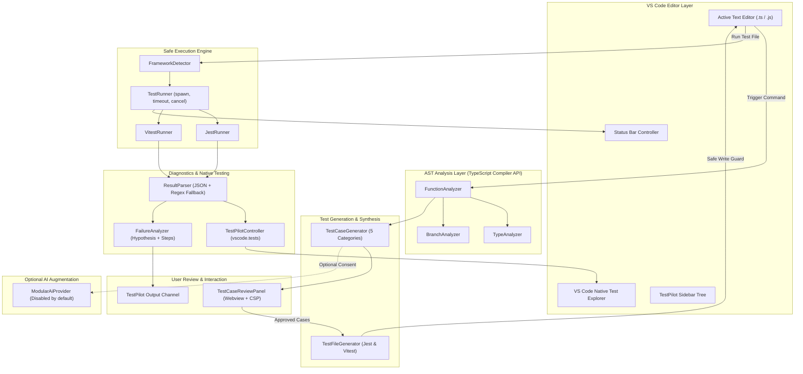
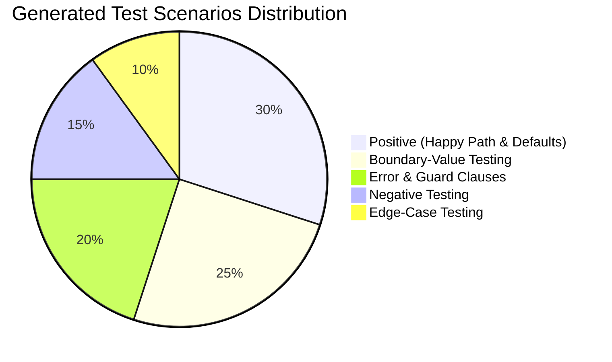

# TestPilot: Comprehensive Technical Documentation & Architecture Manual

> **Extension Name:** TestPilot — Intelligent VS Code Testing Assistant  
> **Version:** 1.0.0  
> **Target Platform:** Visual Studio Code (Engine `^1.85.0`)  
> **Primary Languages:** TypeScript / JavaScript  
> **Supported Testing Frameworks:** Jest, Vitest  
> **Core Operating Model:** 100% Offline-First, Local AST-Driven, Zero AI Credentials Required  

---

## Table of Contents

1. [Executive Summary & Product Vision](#1-executive-summary--product-vision)
2. [High-Level Architecture & Component Map](#2-high-level-architecture--component-map)
3. [Deep-Dive Feature Breakdown](#3-deep-dive-feature-breakdown)
   - [Feature A: Extension Commands & Palette Integration](#feature-a-extension-commands--palette-integration)
   - [Feature B: AST-Based Source Code Analysis](#feature-b-ast-based-source-code-analysis)
   - [Feature C: Categorized Test Case Generation](#feature-c-categorized-test-case-generation)
   - [Feature D: Interactive Review Interface (Webview)](#feature-d-interactive-review-interface-webview)
   - [Feature E: Test File Synthesis & Safe Writing](#feature-e-test-file-synthesis--safe-writing)
   - [Feature F: Safe Process Execution Engine](#feature-f-safe-process-execution-engine)
   - [Feature G: VS Code Native Testing API Integration](#feature-g-vs-code-native-testing-api-integration)
   - [Feature H: Test Failure Diagnostic Engine](#feature-h-test-failure-diagnostic-engine)
   - [Feature I: Modular Offline-First AI Provider](#feature-i-modular-offline-first-ai-provider)
4. [Configuration Reference](#4-configuration-reference)
5. [Security & Threat Mitigation Model](#5-security--threat-mitigation-model)
6. [Developer Operations & Testing](#6-developer-operations--testing)
   - [Local Development & F5 Debugging](#local-development--f5-debugging)
   - [Verification Test Suites](#verification-test-suites)
   - [VSIX Packaging & Installation](#vsix-packaging--installation)
   - [Continuous Integration (GitHub Actions)](#continuous-integration-github-actions)
7. [Troubleshooting & Frequently Asked Questions](#7-troubleshooting--frequently-asked-questions)

---

## 1. Executive Summary & Product Vision

Writing comprehensive unit tests is one of the most critical yet time-consuming tasks in modern software engineering. Developers frequently skip boundary conditions, fail to guard against subtle runtime errors, or struggle to interpret cryptic stack traces when tests fail. 

**TestPilot** solves this directly inside Visual Studio Code. Rather than acting as a simple wrapper around third-party cloud LLMs or providing generic snippets, TestPilot is built on a **deterministic, local AST analysis foundation**. It inspects the syntax, type annotations, conditional guards, and thrown exceptions of JavaScript and TypeScript code to synthesize comprehensive, classified unit test suites.

### Core Philosophy
1. **Privacy & Offline Integrity:** No code leaves your workstation by default. Core functionality is 100% self-contained.
2. **Deterministic Quality over Hallucinations:** Distinguish test suggestions from verified assertions. Guard conditions and thrown exceptions are traced directly to exact AST nodes.
3. **Deep VS Code Integration:** Uses native VS Code APIs — `vscode.tests.createTestController` for the Test Explorer, `vscode.window.createWebviewPanel` with native design tokens for reviewing, and controlled `child_process.spawn` for process isolation.

---

## 2. High-Level Architecture & Component Map

The following architectural diagram illustrates how data flows through TestPilot:



### Directory Structure

```
testpilot/
├── src/
│   ├── extension.ts                # Main activation entry point and subscription manager
│   ├── commands/                   # Command handlers
│   │   ├── generateTests.ts        # 'TestPilot: Generate Test Cases'
│   │   ├── generateTestFile.ts     # 'TestPilot: Generate Test File'
│   │   ├── runTests.ts             # 'TestPilot: Run Current Test File'
│   │   ├── analyzeFailure.ts       # 'TestPilot: Analyze Test Failure'
│   │   ├── showTestPilot.ts        # 'TestPilot: Show TestPilot'
│   │   └── configureSettings.ts    # 'TestPilot: Configure Settings'
│   ├── analysis/                   # AST Analysis modules
│   │   ├── functionAnalyzer.ts     # AST Function extraction (declarations, arrows, methods)
│   │   ├── typeAnalyzer.ts         # Type category inference & candidate generator
│   │   └── branchAnalyzer.ts       # Condition & boundary value extractor
│   ├── generators/                 # Test code generation
│   │   ├── testCaseGenerator.ts    # 5-Category test synthesizer & confidence scorer
│   │   └── testFileGenerator.ts    # Jest & Vitest code generator
│   ├── runners/                    # Execution engine
│   │   ├── testRunner.ts           # Safe process execution base (timeout, cancel, args)
│   │   ├── jestRunner.ts           # Jest CLI runner with JSON reporter flags
│   │   ├── vitestRunner.ts         # Vitest CLI runner with JSON reporter flags
│   │   └── frameworkDetector.ts    # Package manager and framework auto-detection
│   ├── testing/                    # Native Testing API
│   │   └── testController.ts       # vscode.TestController implementation & tree hierarchy
│   ├── reports/                    # Diagnostic & reporting
│   │   ├── resultParser.ts         # JSON and text result parser
│   │   └── failureAnalyzer.ts      # Structured hypothesis & remediation generator
│   ├── providers/                  # Modular AI integration
│   │   ├── providerTypes.ts        # Provider interfaces & response schemas
│   │   └── aiProvider.ts           # Offline-first provider with validation & consent guards
│   ├── views/                      # UI Views
│   │   ├── testCaseReviewPanel.ts  # Interactive Webview review panel
│   │   ├── statusBar.ts            # Status bar manager
│   │   └── overviewTreeProvider.ts # Sidebar tree data provider
│   └── utils/                      # Core Utilities
│       ├── workspace.ts            # Safe file I/O & overwrite modal prompts
│       ├── logger.ts               # OutputChannel logger with log levels
│       └── validation.ts           # Security validators (path traversal, schemas)
├── test/
│   ├── setup.js                    # Node/Mocha VS Code API runtime mock
│   ├── unit/                       # Unit tests (AST, generators, parsers, diagnostics)
│   ├── integration/                # Integration tests (process execution, workspace)
│   ├── security/                   # Security tests (path traversal, malicious code)
│   └── fixtures/                   # Runnable test projects
│       ├── javascript-project/     # Jest JS fixture with runnable tests
│       └── typescript-project/     # Vitest TS fixture with runnable tests
├── package.json                    # Extension manifest
├── tsconfig.json                   # TypeScript configuration
├── .eslintrc.json                  # ESLint configuration
├── .prettierrc                     # Prettier formatting configuration
└── .github/workflows/ci.yml        # Multi-OS GitHub Actions CI workflow
```

---

## 3. Deep-Dive Feature Breakdown

### Feature A: Extension Commands & Palette Integration

TestPilot registers 6 native commands in the VS Code Command Palette and binds appropriate context menus.

| Command ID | Display Label | Context Menu Triggers | Description |
| :--- | :--- | :--- | :--- |
| `testpilot.generateTestCases` | `TestPilot: Generate Test Cases` | Editor Context Menu on JS/TS selection | Analyzes the function enclosing the cursor/selection and opens the interactive review panel. |
| `testpilot.generateTestFile` | `TestPilot: Generate Test File` | Editor Context Menu on JS/TS files | Generates and saves a test file immediately without opening the full Webview. |
| `testpilot.runCurrentTestFile` | `TestPilot: Run Current Test File` | Editor Context Menu on `*.test.*` or `*.spec.*` | Executes the active test file or automatically discovers its companion test file. |
| `testpilot.analyzeTestFailure` | `TestPilot: Analyze Test Failure` | Editor Context Menu / Notification Action | Formulates structured hypotheses and debugging steps from recent failures. |
| `testpilot.showTestPilot` | `TestPilot: Show TestPilot` | Command Palette / Status Bar click | Reveals the sidebar view container or opens the quick action launcher. |
| `testpilot.configureSettings` | `TestPilot: Configure Settings` | Sidebar action / Command Palette | Navigates directly to the `testpilot.*` settings section in VS Code. |

---

### Feature B: AST-Based Source Code Analysis

Implemented in [`src/analysis/functionAnalyzer.ts`](file:///c:/Users/shoeb.DESKTOP-9N26K36/OneDrive/Desktop/Testpilot/src/analysis/functionAnalyzer.ts).

Rather than relying on error-prone regular expressions, TestPilot uses the official **TypeScript Compiler API** (`ts.createSourceFile`, `ts.Node`, `ts.SyntaxKind`) to inspect the Abstract Syntax Tree.

#### Supported Node Types:
1. **Function Declarations:** `function divide(a, b) { ... }`, `export function ...`, `export default function ...`
2. **Variable Statements with Function Expressions / Arrows:**
   - `const add = (a: number, b: number): number => { ... }`
   - `export const multiply = function(a, b) { ... }`
3. **Class Methods:** `class Calculator { divide(a, b) { ... } }`

#### Extracted Metadata:
- **Parameters (`ParameterInfo`):** Name, type annotation text (`number`, `string`, `boolean`, `Array<T>`, unions), default initializers (`discountRate = 0.1`), optional flags (`?`), and rest parameter markers (`...args`).
- **Return Expressions:** AST visitor traverses the function block to identify all `return <expr>;` statements.
- **Thrown Exceptions (`ThrownErrorInfo`):** Visits `ts.ThrowStatement` and `ts.NewExpression` nodes to capture exact error types (e.g., `Error`, `RangeError`, `TypeError`) and string message literals.
- **Branch Conditions (`BranchConditionInfo`):** Extracts `ts.IfStatement`, `ts.ConditionalExpression` (ternary), and detects guard clauses (statements that immediately throw or return at function entry).

---

### Feature C: Categorized Test Case Generation

Implemented in [`src/generators/testCaseGenerator.ts`](file:///c:/Users/shoeb.DESKTOP-9N26K36/OneDrive/Desktop/Testpilot/src/generators/testCaseGenerator.ts).

TestPilot organizes test scenarios into 5 structured categories:



1. **Error & Exception Testing (`Error`):**
   - Automatically synthesized by linking AST `throw` statements with their preceding guard clauses.
   - For example, if `if (b === 0) throw new Error("Cannot divide by zero")` is detected, parameter `b` is assigned `0` and marked with `expectedThrows: true`.
2. **Positive Testing (`Positive`):**
   - Happy-path scenarios with standard valid inputs according to parameter types.
   - Generates variations when default parameters exist to verify fallback behavior when optional arguments are omitted.
3. **Boundary-Value Testing (`Boundary`):**
   - Numeric domains: `0`, `1`, `-1`, `Number.MAX_SAFE_INTEGER`, `Number.MIN_SAFE_INTEGER`.
   - String domains: empty string `""`, single character `"a"`, long strings.
   - Array domains: empty array `[]`, single-element array `[1]`.
   - Branch boundaries: condition thresholds (e.g. `price < 0` produces boundary test `price = 0`).
4. **Negative Testing (`Negative`):**
   - Exercises invalid types, out-of-range negatives, `null`, and `undefined`.
5. **Edge-Case Testing (`Edge`):**
   - Tests `NaN`, `Infinity`, unicode characters (`"🚀"`), whitespace strings, and extreme scales.

#### Confidence & Truthfulness
TestPilot explicitly tags cases with confidence levels:
- `verified`: Guard clause throws matched directly to AST expressions.
- `suggested`: Expected output requires developer verification against business logic.
- `manual_review_required`: Negative and edge-case behaviors that depend on external domain rules.

---

### Feature D: Interactive Review Interface (Webview)

Implemented in [`src/views/testCaseReviewPanel.ts`](file:///c:/Users/shoeb.DESKTOP-9N26K36/OneDrive/Desktop/Testpilot/src/views/testCaseReviewPanel.ts).

The review interface allows developers to inspect and tailor generated test cases before writing files:

- **Theme Consistency:** Utilizes standard VS Code CSS variables:
  - Background: `var(--vscode-editor-background)`
  - Foreground: `var(--vscode-editor-foreground)`
  - Buttons: `var(--vscode-button-background)`, `var(--vscode-button-foreground)`
  - Inputs: `var(--vscode-input-background)`, `var(--vscode-input-foreground)`
- **Security:** Strict Content Security Policy (CSP):
  ```html
  <meta http-equiv="Content-Security-Policy" content="default-src 'none'; style-src ${cspSource} 'unsafe-inline'; script-src 'nonce-${nonce}';">
  ```
- **Inline Editing:** Test names and input parameter literals are editable directly in the UI.
- **Framework Switcher:** Toggle between Jest and Vitest syntax in real-time.
- **Bi-directional Message Passing:** Uses `vscode.postMessage` and `onDidReceiveMessage` to maintain synchronized state between webview and extension host.

---

### Feature E: Test File Synthesis & Safe Writing

Implemented in [`src/generators/testFileGenerator.ts`](file:///c:/Users/shoeb.DESKTOP-9N26K36/OneDrive/Desktop/Testpilot/src/generators/testFileGenerator.ts) and [`src/utils/workspace.ts`](file:///c:/Users/shoeb.DESKTOP-9N26K36/OneDrive/Desktop/Testpilot/src/utils/workspace.ts).

#### Framework-Specific Syntax:
- **Vitest:**
  ```typescript
  import { describe, it, expect } from 'vitest';
  import { divide } from './math';

  describe('divide', () => {
    it('should throw Error when b is 0', () => {
      expect(() => divide(10, 0)).toThrow('Cannot divide by zero');
    });
  });
  ```
- **Jest:**
  ```typescript
  import { divide } from './math';

  describe('divide', () => {
    it('should throw Error when b is 0', () => {
      expect(() => divide(10, 0)).toThrow('Cannot divide by zero');
    });
  });
  ```

#### Overwrite Protection:
Before writing any file to disk:
1. TestPilot checks if the target path exists using `vscode.workspace.fs.stat`.
2. If the file exists, it displays a modal warning dialog:
   ```
   File already exists: "math.test.ts". Overwrite existing file?
   [ Overwrite ]  [ Choose New Location ]  [ Cancel ]
   ```
3. If "Choose New Location" is picked, `vscode.window.showSaveDialog` opens, allowing the developer to safely specify a new destination.

---

### Feature F: Safe Process Execution Engine

Implemented in [`src/runners/testRunner.ts`](file:///c:/Users/shoeb.DESKTOP-9N26K36/OneDrive/Desktop/Testpilot/src/runners/testRunner.ts).

Running project tests requires executing Node.js binaries. TestPilot implements strict security measures to ensure safety:

1. **Controlled Argument Arrays:** Processes are launched with `spawn(command, [args])` rather than concatenating arbitrary strings inside a shell.
2. **Platform-Specific Binary Resolution:**
   - Searches local `node_modules/.bin/` before falling back to `npx`.
   - On Windows, uses `.cmd` binaries without exposing the execution to shell interpolation unless specifically running batch scripts.
3. **Execution Guards:**
   - **Timeout Enforcement:** Default 30,000ms timeout (configurable via `testpilot.executionTimeout`).
   - **Cancellation Tokens:** Integrated with `vscode.CancellationToken` so developers can cancel running tests at any moment. On Windows, calls `taskkill /pid <PID> /f /t` to clean up child process trees.
   - **Environment Isolation:** Passes `CI=true` and `FORCE_COLOR=0` to ensure non-interactive, machine-readable output.

---

### Feature G: VS Code Native Testing API Integration

Implemented in [`src/testing/testController.ts`](file:///c:/Users/shoeb.DESKTOP-9N26K36/OneDrive/Desktop/Testpilot/src/testing/testController.ts).

TestPilot integrates directly with VS Code's official Testing API via `vscode.tests.createTestController`:

```
TEST EXPLORER
└── 🧪 TestPilot
    └── 📄 math.test.ts
        └── 📂 Suite: divide
            ├──  should divide two positive numbers
            └──  should throw Error when dividing by zero
```

- **File System Watcher:** Monitors workspace files matching `**/*.{test,spec}.{js,ts,jsx,tsx}` and dynamically updates the test tree when files are created, modified, or deleted.
- **Run Profiles:** Provides a `vscode.TestRunProfileKind.Run` handler. Clicking the "Play" icon in the VS Code Test Explorer launches the test suite, parses output, and marks individual test items as passed or failed with detailed `vscode.TestMessage` attachments.

---

### Feature H: Test Failure Diagnostic Engine

Implemented in [`src/reports/failureAnalyzer.ts`](file:///c:/Users/shoeb.DESKTOP-9N26K36/OneDrive/Desktop/Testpilot/src/reports/failureAnalyzer.ts).

When a test fails, TestPilot parses stdout/stderr and constructs a structured Markdown diagnostic report:

```markdown
## 🔍 TestPilot Failure Diagnostic Report
**Test:** `should calculate quotient`
**Location:** [math.test.ts:18](file:///c:/workspace/src/math.test.ts#L18)

### 1. Failure Summary
> Error: expect(received).toBe(expected)

### 2. Available Evidence
- **Expected:** `10`
- **Received:** `5`
- **Failure Line:** 18

### 3. Likely Cause (Hypothesis)
*Note: This is an analytical hypothesis based on available evidence, not an absolute guarantee.*
**Category:** `ASSERTION_MISMATCH`
Hypothesis: The function returned 5, but the test expected 10. This suggests a calculation or conditional branch difference.

### 4. Suggested Debugging Steps
- [ ] Compare actual result (5) against expected specification (10).
- [ ] Inspect return expression and branch conditions in source function.

### 5. Relevant Stack Trace
```

#### Diagnostic Hypotheses Categories:
- `ASSERTION_MISMATCH`: Expected and actual values differed.
- `UNEXPECTED_EXCEPTION`: Unhandled exception thrown outside test expectations.
- `TIMEOUT_ERROR`: Async execution or loop exceeded timeout limit.
- `NULL_POINTER_OR_TYPE_ERROR`: Attempt to access properties on `null` or `undefined`.
- `MODULE_OR_IMPORT_ERROR`: Missing dependency or unresolved module import.

---

### Feature I: Modular Offline-First AI Provider

Implemented in [`src/providers/aiProvider.ts`](file:///c:/Users/shoeb.DESKTOP-9N26K36/OneDrive/Desktop/Testpilot/src/providers/aiProvider.ts).

- **Offline-First Guarantee:** AI features are **disabled by default**. All core features (analysis, test case generation, execution, native testing, failure diagnostics) work 100% offline.
- **Zero Hardcoded Secrets:** Keys are configured in user settings or VS Code secret storage.
- **User Consent Prompts:** Source code is never transmitted without an explicit prompt displaying the function name and size.
- **Strict Response Validation:** All incoming AI payloads pass through `ValidationUtils.validateAiScenarioPayload` before rendering.

---

## 4. Configuration Reference

All settings can be customized in `.vscode/settings.json` or through the VS Code Settings UI:

| Setting Key | Type | Default | Options | Description |
| :--- | :--- | :--- | :--- | :--- |
| `testpilot.defaultFramework` | `string` | `"auto"` | `"auto"`, `"jest"`, `"vitest"` | Target test framework. When `"auto"`, detects framework from `package.json` and configs. |
| `testpilot.testFileNaming` | `string` | `"[name].test.[ext]"` | `"[name].test.[ext]"`, `"[name].spec.[ext]"` | Naming convention used when creating new test files. |
| `testpilot.testDirectory` | `string` | `"same-directory"` | `"same-directory"`, `"__tests__"`, `"test"`, `"tests"` | Destination folder for newly generated test files. |
| `testpilot.executionTimeout` | `number` | `30000` | `1000` – `120000` | Maximum execution time (in ms) before terminating a test run. |
| `testpilot.preferredPackageManager` | `string` | `"auto"` | `"auto"`, `"npm"`, `"yarn"`, `"pnpm"` | Binary to use when launching test suites. |
| `testpilot.ai.enabled` | `boolean` | `false` | `true`, `false` | Enable optional AI augmentation for edge cases. |
| `testpilot.ai.provider` | `string` | `"offline"` | `"offline"`, `"openai-compatible"`, `"anthropic-compatible"` | Provider type for AI integration. |
| `testpilot.ai.model` | `string` | `""` | e.g. `"gpt-4o-mini"` | Model identifier. |
| `testpilot.ai.apiKey` | `string` | `""` | string | API key for configured provider. |

---

## 5. Security & Threat Mitigation Model

| Threat Vector | Mitigation Strategy Implemented in TestPilot |
| :--- | :--- |
| **Command Injection** | Process execution uses argument arrays in `child_process.spawn`. Shell interpretation is disabled for binary calls, preventing shell expansion attacks. |
| **Path Traversal Attacks** | All target paths are checked with `ValidationUtils.isSafePath` to verify that file writes cannot escape the workspace directory. |
| **Accidental Overwrites** | File writes verify existing files with `WorkspaceUtils.safeWriteFile` and prompt a modal dialog before writing. |
| **Data Exfiltration** | Core AST analysis and test generation run 100% locally. The AI provider is inactive by default and requires interactive consent before transmitting source snippets. |
| **Webview Script Injection** | Webview review panels enforce strict Content Security Policy (CSP) with unique cryptographic nonces for script tags. |
| **Malformed Source Files** | AST parser wraps source file parsing in defensive error handlers, ensuring broken user code never crashes the extension. |

---

## 6. Developer Operations & Testing

### Local Development & F5 Debugging

1. Clone or open the repository in VS Code.
2. Install dependencies:
   ```bash
   npm install
   ```
3. Open the **Run and Debug** view (`Ctrl+Shift+D` / `Cmd+Shift+D`) and select **Run TestPilot Extension**.
4. Press **F5**. A new VS Code Extension Development Host will launch with TestPilot active.

### Verification Test Suites

TestPilot includes a comprehensive test suite executed with Mocha:

```bash
# Run all 24 unit, integration, and security tests
npm test

# Run unit tests
npm run test:unit

# Run integration tests
npm run test:integration

# Run security tests
npm run test:security

# Run ESLint checks
npm run lint

# Run Prettier code formatting
npm run format
```

#### Test Execution Summary:
```
  FailureAnalyzer Unit Tests
    ✔ should detect assertion mismatch and produce hypothesis and debugging steps
    ✔ should detect null pointer type error and categorize accurately
    ✔ should detect timeout error
  FrameworkDetector Unit Tests
    ✔ should detect environment for active folder without throwing
  FunctionAnalyzer Unit Tests
    ✔ should analyze standard function declarations with parameters and throw statements
    ✔ should analyze exported TypeScript arrow functions with type annotations
    ✔ should find function at specific offset position
  ResultParser Unit Tests
    ✔ should parse Jest JSON output accurately
    ✔ should parse raw text output when JSON is not available
  TestCaseGenerator Unit Tests
    ✔ should generate categorized test cases for division with guard clause
    ✔ should generate optional parameter handling case when default exists
  TestFileGenerator Unit Tests
    ✔ should generate valid Jest test file content with proper imports and expectations
    ✔ should generate valid Vitest test file content with vitest imports
  TestRunner Integration Tests
    ✔ should execute a safe command and return stdout and exit code 0
    ✔ should handle non-zero exit code accurately without claiming success
    ✔ should trigger timeout when execution exceeds timeout limit
  WorkspaceUtils Integration Tests
    ✔ should compute relative import paths cleanly with forward slashes
    ✔ should compute relative import paths in same directory
    ✔ should correctly identify test files by naming convention
  Security & Resilience Unit Tests
    ✔ should handle malformed or invalid JavaScript/TypeScript source gracefully
    ✔ should detect and prevent directory traversal attacks
    ✔ should reject invalid file paths containing illegal characters or null bytes
    ✔ should handle unexpected or corrupted test runner output safely
    ✔ should strictly validate AI payload schema and reject malformed items

  24 passing (1s)
```

### VSIX Packaging & Installation

Package the extension into an installable `.vsix` bundle using `@vscode/vsce`:

```bash
npm run package
```

This generates `testpilot-1.0.0.vsix` in the workspace root. Install it via CLI:

```bash
code --install-extension testpilot-1.0.0.vsix
```

Or via VS Code UI:
1. Open the Extensions View (`Ctrl+Shift+X` / `Cmd+Shift+X`).
2. Click the `...` (Views and More Actions) menu in the top right.
3. Select **Install from VSIX...** and pick `testpilot-1.0.0.vsix`.

---

## 7. Troubleshooting & Frequently Asked Questions

### Q: Why does TestPilot say "No function declarations found"?
**A:** Ensure your cursor is positioned inside a supported function definition (function declaration, exported arrow function, or class method), or select the function block directly.

### Q: Can TestPilot run without an internet connection?
**A:** Yes. TestPilot is completely self-contained. AST analysis, test generation, file writing, test execution, and failure diagnostics run locally on your machine.

### Q: What if my project uses both Jest and Vitest?
**A:** TestPilot automatically inspects configuration files (`vitest.config.ts`, `jest.config.js`) and dependencies. You can also explicitly choose the framework in the review panel dropdown or configure `"testpilot.defaultFramework": "vitest"` in settings.

### Q: Why does running tests fail with "Cannot find module 'jest'"?
**A:** TestPilot runs tests using your project's local dependencies. Ensure you have run `npm install` (or `pnpm install` / `yarn install`) in the target workspace.
